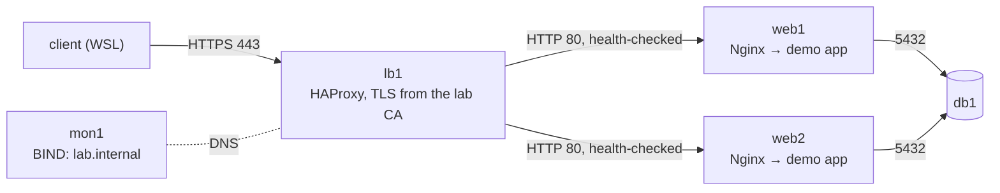
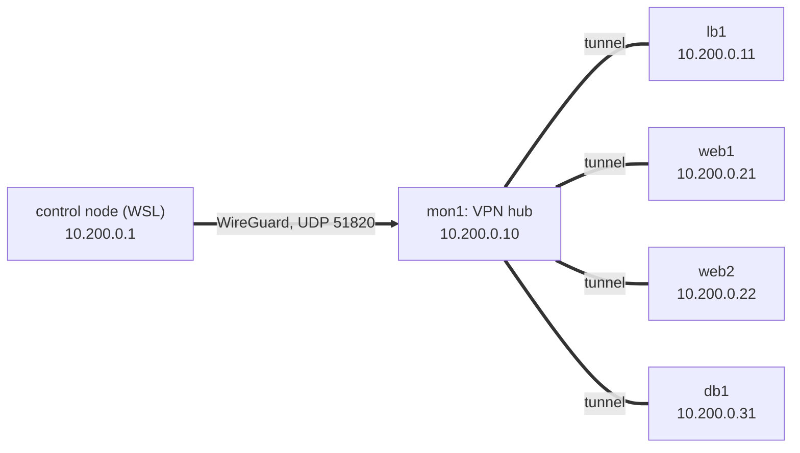

# infra-ops-lab

A hands-on Linux and network operations lab: a tested Bash toolkit, Ansible-managed VMs,
networking (DNS, load balancing, TLS, VPN), firewalls, a Windows Server node and security monitoring.
Everything runs locally at no cost.


## Roadmap

| Step | What | Status |
|---|---|---|
| 1 | Bash toolkit (health check, log triage, backup/restore) with tests and CI | done |
| 2 | Three Linux VMs managed by Ansible: users, SSH hardening, nftables firewall | done |
| 3a | Internal DNS (BIND), demo app behind Nginx, HAProxy load balancing with HTTPS from a lab CA | done |
| 3b | WireGuard VPN for admin access, hub and spokes, admin ports reachable through the VPN only | done |
| 4 | Toolkit on every VM: systemd timers, nightly backups, log reports and rotation, real client IPs, incident drills | done |
| 5 | The Nginx role rewritten in Puppet, migrated host by host (canary, rollout, rollback), drift corrected every 30 minutes | done |
| 6 | Windows Server node configured with PowerShell | |
| 7 | Wazuh SIEM detecting an SSH brute-force attack; network diagram | |

## Bash toolkit (`scripts/`)

| Script | What it does | What it catches |
|---|---|---|
| `healthcheck.sh` | Checks disk and memory against WARN:CRIT thresholds, systemd services and an HTTP endpoint | A full disk, memory pressure, a stopped service, an endpoint that stopped answering |
| `log-triage.sh` | Summarises auth, Nginx access and application logs, including rotated `.gz` files | SSH brute-force sources, spikes of 4xx/5xx, the failing endpoints, the most frequent errors |
| `backup.sh` | Compressed, timestamped backups with SHA-256 checksums and rotation | Lost data, with a fixed number of restore points |
| `restore.sh` | Verifies the checksum before restoring | Restoring a corrupted or tampered archive |

`healthcheck.sh` uses the Nagios exit codes (0 OK, 1 WARNING, 2 CRITICAL, 3 UNKNOWN),
so any monitoring system or systemd timer can act on it.

### Examples

```bash
# disk, memory, two services and the app's health endpoint
./scripts/healthcheck.sh -d 80:90 -m 85:95 -s nginx,ssh -u http://localhost:8000/health

# who is trying to log in over SSH, and from where
./scripts/log-triage.sh -b 5 /var/log/auth.log /var/log/auth.log.2.gz

# what is failing in the web tier
./scripts/log-triage.sh /var/log/nginx/access.log

# keep 7 days of backups, then prove they restore
./scripts/backup.sh -s /etc/nginx -d /var/backups/nginx -k 7
./scripts/restore.sh -a /var/backups/nginx/nginx-20261117T100000Z.tar.gz -t /tmp/restore-test
```

## Step 2: VMs managed by Ansible (`vms/`, `ansible/`)

Ubuntu 24.04 VMs created with Multipass on Hyper-V and configured by Ansible from WSL.

| VM | Role | Open ports (inbound) |
|---|---|---|
| `lb1` | HTTPS load balancer | 80 and 443 from anywhere, 8404 (HAProxy stats) from admin networks |
| `web1`, `web2` | web tier | 80 **from the load balancer only** |
| `db1` | database | 5432 **from the web tier only** |
| `mon1` | DNS and monitoring | 53 from the lab VMs; 9090 and 3000 from admin networks |
| all | | 22 from admin networks, 9100 (node_exporter) from `mon1` only; everything else is dropped |

| Ansible role | What it does |
|---|---|
| `base` | Baseline packages, timezone, automatic security updates |
| `users` | An `ops` admin account with the lab SSH key only (`exclusive`), sudo through a `visudo`-checked drop-in |
| `ssh_hardening` | Key-only logins, no root login, `AllowUsers`, short login grace time; validated with `sshd -t` before sshd restarts |
| `firewall` | nftables with a default-drop input policy, rules generated per group from `group_vars`; validated with `nft -c` before it is installed |

## Step 3a: DNS, load balancing and HTTPS



| Ansible role | What it does |
|---|---|
| `tls_ca` | Creates a lab certificate authority **on the control node** (its key never leaves it) and signs a certificate for `www.lab.internal` |
| `trust_ca` | Installs the CA certificate in every VM's trust store |
| `dns_server` | BIND on `mon1`, authoritative for `lab.internal`; the zone is generated from the inventory and checked with `named-checkzone` |
| `resolver` | systemd-resolved sends only `*.lab.internal` lookups to `mon1` (routing domain `~lab.internal`) |
| `app` | A small Python service that reports which VM answered, run by systemd as a throwaway user (`DynamicUser`, read-only system) |
| `nginx` | Reverse proxy in front of the app; logs in the `combined` format that `scripts/log-triage.sh` reads |
| `haproxy` | Terminates HTTPS (TLS 1.2 minimum, HSTS), redirects HTTP to HTTPS, round-robins across the web tier with health checks; config checked with `haproxy -c` |

Failover: stop Nginx on `web1` and every request goes to `web2` within about 4 seconds
(2 failed health checks, 2 seconds apart); start it again and the traffic is shared again.

## Step 3b: WireGuard VPN for admin access



Every VM and the control node keep one tunnel to the hub, `mon1`. The hub routes the control
node's traffic to the VMs and nothing else: a VM cannot reach another VM through the VPN
(they talk over the lab network, as before).

| What | How |
|---|---|
| Private keys never leave their machine | Each VM creates its key with `wg genkey`; Ansible only reads the public key, and `wg-quick` loads the private key from a root-only file (`PostUp`) |
| Admin pages only through the VPN | `lb1:8404` (HAProxy stats), and later Prometheus and Grafana on `mon1`, accept `10.200.0.1` only |
| The hub routes admin traffic only | `net.ipv4.ip_forward=1` on `mon1`, and an nftables forward chain that accepts `wg0 → wg0` from `10.200.0.1` and drops the rest |
| Spokes stay reachable | Spokes send a keepalive every 25 s; when the hub restarts, Ansible restarts the spokes so they reconnect at once |

Roles: `wireguard` (every VM) and `wireguard_client` (the control node; its key and config
go to `ansible/wg/`, which is never committed). SSH stays open from the admin networks as
well, because Multipass itself connects over SSH.

`make verify` proves it: every VM answers at its VPN address, the stats page answers
through the VPN and times out outside it, and `web1` reaches the hub through the VPN but
cannot reach `db1` through it.

## Step 4: the toolkit in production on every VM

The Bash toolkit from step 1 is installed in `/usr/local/lib/infra-ops` (with links in
`/usr/local/bin`) and runs on a schedule:

| Timer | When | What |
|---|---|---|
| `healthcheck.timer` | every 5 minutes | `healthcheck.sh` with each group's services and endpoint (web: Nginx, the app and `/health`; lb: HAProxy; mon: BIND; all: nftables and the VPN tunnel). A WARNING or CRITICAL run fails the unit: it shows in `systemctl --failed`, the details in `journalctl -u healthcheck` |
| `backup.timer` | every night around 02:30; a missed run catches up at boot (`Persistent=true`) | `backup.sh` of `/etc` into `/var/backups/infra-ops`, 7 kept, readable by root only (they hold private keys) |
| `triage-report.timer` | every morning, web tier | `log-triage.sh` on the Nginx access log, appended to `/var/log/infra-ops/triage.log`, which logrotate rotates weekly |

- **Least privilege:** the checks and reports run as the `infra-ops` system account (no
  password, no shell, member of `adm` to read logs) on a read-only system
  (`ProtectSystem=strict`). The backup runs as root but can only write to its own folder.
- **Real client addresses:** HAProxy adds `X-Forwarded-For`, and Nginx trusts that header
  from `lb1` only (`set_real_ip_from`). The access logs, and `log-triage.sh`, show the
  client instead of the load balancer, and a client cannot fake its address.
- `make health` runs the health check on every VM and shows the reports.

`make verify` proves it: the timers are active, the health check passes on every VM, a fresh
backup restores after its checksum is checked, and a tagged request is logged with the
client's address.

### Incident drills

**Drill 1: a web server goes down.** From `ansible/`:

```bash
ansible web1 -b -a "systemctl stop nginx"           # the incident
LB=$(awk '/^lb1 /{ sub("ansible_host=", "", $2); print $2 }' inventory.ini)
for i in 1 2 3 4 5 6; do                            # the site still answers, from web2 only
  curl -s --noproxy '*' --cacert pki/ca.crt --resolve "www.lab.internal:443:$LB" \
    https://www.lab.internal/ | grep -o '"served_by": "[a-z0-9]*"'
done
curl -s --noproxy '*' "http://10.200.0.11:8404/stats;csv" | awk -F, '$1 == "web" { print $2, $18 }'
ansible web1 -b -a "systemctl start healthcheck.service"     # fails: nginx inactive, /health down
ansible web1 -b -a "journalctl -u healthcheck.service -n 8 -o cat"
ansible web1 -b -a "systemctl start nginx"          # the fix: web1 is back in about 4 seconds
```

**Drill 2: a disk fills up.** On `db1` (`vms/vms.sh ssh db1`):

```bash
need=$(df --output=size,used -B1 / | awk 'NR == 2 { print int($1 * 0.92 - $2) }')
sudo fallocate -l "$need" /var/tmp/drill.fill       # reserves the space at once, writes nothing
df -h /
sudo systemctl start healthcheck.service            # fails: disk CRITICAL
systemctl --failed
sudo journalctl -u healthcheck.service -n 8 -o cat
sudo rm /var/tmp/drill.fill                         # the fix
sudo systemctl start healthcheck.service            # passes again
```

The first run of drill 1 lost one request: the one sent in the 4 seconds before HAProxy's
health checks marked `web1` down. HAProxy now retries a refused connection once on the
other server (`retries 1`, `option redispatch 1`), and the drill loses no request.

Postmortems of the drills are in [`docs/postmortems/`](docs/postmortems/), for example
[web1 stops serving](docs/postmortems/2026-11-23-web1-down.md).

After each drill, write a short postmortem: what happened, the impact (drill 1: none, web2
took over), how it was detected and how fast (HAProxy in 4 seconds, the health check within
5 minutes), and the fix.

## Step 5: the Nginx role rewritten in Puppet (`puppet/`)

The Puppet class `demo_web` writes the same Nginx configuration as the Ansible role `nginx`.
It runs without a Puppet server: Ansible installs Puppet, copies `puppet/` to the web VMs,
writes the Hiera data from the inventory (`data/lab.yaml`), and a systemd timer runs
`puppet apply` every 30 minutes. A manual change to the Nginx configuration is put back at
the next run.

| | Ansible (role `nginx`) | Puppet (class `demo_web`) |
|---|---|---|
| When it runs | When someone runs the playbook (push) | Every 30 minutes on each VM, enforcing the code |
| Template | Jinja2, `demo-app.conf.j2` | EPP, `site.conf.epp` |
| Data | Inventory and `group_vars` | Hiera: `data/lab.yaml` (written by Ansible), `data/common.yaml` |
| Test before reload | `nginx -t` task; handlers reload at the end | `exec` `nginx -t` (refreshonly) notifies the service; a failed test skips the reload |
| Idempotent | A second run: `changed=0` | A second run: exit code 0 (`--detailed-exitcodes`) |

How it is proved:

- `make puppet-test` (also in CI): the Puppet code compiles in no-op mode, and the site
  file it renders is identical to the Ansible role's, apart from the "Managed by" line.
- `make verify`: the same HTTPS, load-balancing and client-address checks as before, plus,
  on each Puppet VM, a second Puppet run changes nothing and a manual edit is reverted.

Migration, one host at a time (`web_config_tool` chooses the tool):

1. **Canary:** `host_vars/web2.yml` puts `web2` on Puppet; `web1` stays on Ansible.
   `make provision`, then `make verify`.
2. **Rollout:** set `web_config_tool: puppet` in `group_vars/web.yml`, delete
   `host_vars/web2.yml`, then `make provision` and `make verify`.
3. **Rollback, if needed:** set it back to `ansible`. The role `nginx` stops the Puppet
   timer and takes the files back.

### Run it

```bash
make vms         # create the VMs (existing ones are kept) and write ansible/inventory.ini
make ping        # Ansible reaches every VM
make provision   # apply the baseline (run it twice: the second run changes nothing)
make vpn-up      # start the control node's tunnel (needs: sudo apt install wireguard-tools)
make verify      # prove it: SSH, firewall, sudo, DNS, HTTPS, load balancing, VPN, toolkit
make health      # health check of every VM, now
make vms-down    # delete the VMs
```

`make verify` checks the result instead of trusting the playbook. For example, it opens
TCP 5432 on `db1` from `web1` (connection refused: the firewall let it through) and from
`mon1` (timed out: the firewall dropped it), resolves every VM by name from every VM, and
sends 6 HTTPS requests through `lb1` to check that both web servers answer behind a
certificate signed by the lab CA.

**Windows 10 note:** WSL and Hyper-V VMs are on separate virtual switches, so WSL cannot reach
the VMs until forwarding is enabled. Run `vms/fix-wsl-routing.ps1` in an administrator
PowerShell; Windows resets it at every reboot.

**After a reboot** the VMs can come back with each other's addresses. Run `make inventory`:
it reads every address in one `multipass list` call, rewrites the inventory, and forgets the
stored SSH host key of each address that moved to another VM, so SSH does not refuse the
connection. An address that kept its VM keeps its key, so a changed key there is still refused.
The lab uses its own `~/.ssh/infra_lab_known_hosts`, which leaves your other servers' entries alone.
Then run `make provision` (the VPN endpoints use the new addresses) and `make vpn-up`.

## Tests and CI

Every script is linted with [ShellCheck](https://www.shellcheck.net/) and tested with
[bats](https://github.com/bats-core/bats-core) (29 tests). The playbooks pass
[ansible-lint](https://ansible.readthedocs.io/projects/lint/) at its strictest (`production`) profile
and an Ansible syntax check. The Puppet code passes `puppet parser validate` and
[puppet-lint](http://puppet-lint.com/) with warnings as errors, and `make puppet-test`.
Fixtures in `tests/fixtures/` stand in for `df`, `/proc/meminfo`, `systemctl`, `multipass`
and real logs, so the tests give the same result on any machine. GitHub Actions runs the
three jobs (Bash, Ansible, Puppet) on every push.

```bash
make lint           # shellcheck
make test           # bats
make ansible-lint   # ansible-lint
make puppet-lint    # puppet parser validate, puppet-lint
make puppet-test    # Puppet and Ansible write the same Nginx site
make                # shellcheck + bats
```
