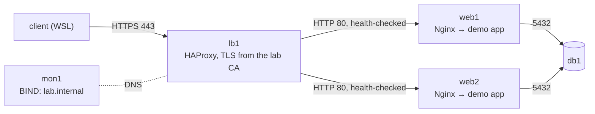

# infra-ops-lab

A hands-on Linux and network operations lab: a tested Bash toolkit, Ansible-managed VMs,
networking (DNS, load balancing, TLS, VPN), firewalls, a Windows Server node and security monitoring.
Everything runs locally at no cost.


## Roadmap

| Step | What | Status |
|---|---|---|
| 1 | Bash toolkit (health check, log triage, backup/restore) with tests and CI | done |
| 2 | Three Linux VMs managed by Ansible: users, SSH hardening, nftables firewall | done |
| 3a | Internal DNS (BIND), demo app behind Nginx, HAProxy load balancing with HTTPS from a lab CA | done |
| 3b | WireGuard VPN | |
| 4 | Toolkit deployed as systemd timers, log rotation | |
| 5 | The Nginx role rewritten in Puppet | |
| 6 | Windows Server node configured with PowerShell | |
| 7 | Wazuh SIEM detecting an SSH brute-force attack; network diagram | |

## Bash toolkit (`scripts/`)

| Script | What it does | What it catches |
|---|---|---|
| `healthcheck.sh` | Checks disk and memory against WARN:CRIT thresholds, systemd services and an HTTP endpoint | A full disk, memory pressure, a stopped service, an endpoint that stopped answering |
| `log-triage.sh` | Summarises auth, Nginx access and application logs, including rotated `.gz` files | SSH brute-force sources, spikes of 4xx/5xx, the failing endpoints, the most frequent errors |
| `backup.sh` | Compressed, timestamped backups with SHA-256 checksums and rotation | Lost data, with a fixed number of restore points |
| `restore.sh` | Verifies the checksum before restoring | Restoring a corrupted or tampered archive |

`healthcheck.sh` uses the Nagios exit codes (0 OK, 1 WARNING, 2 CRITICAL, 3 UNKNOWN),
so any monitoring system or systemd timer can act on it.

### Examples

```bash
# disk, memory, two services and the app's health endpoint
./scripts/healthcheck.sh -d 80:90 -m 85:95 -s nginx,ssh -u http://localhost:8000/health

# who is trying to log in over SSH, and from where
./scripts/log-triage.sh -b 5 /var/log/auth.log /var/log/auth.log.2.gz

# what is failing in the web tier
./scripts/log-triage.sh /var/log/nginx/access.log

# keep 7 days of backups, then prove they restore
./scripts/backup.sh -s /etc/nginx -d /var/backups/nginx -k 7
./scripts/restore.sh -a /var/backups/nginx/nginx-20261117T100000Z.tar.gz -t /tmp/restore-test
```

## Step 2: VMs managed by Ansible (`vms/`, `ansible/`)

Ubuntu 24.04 VMs created with Multipass on Hyper-V and configured by Ansible from WSL.

| VM | Role | Open ports (inbound) |
|---|---|---|
| `lb1` | HTTPS load balancer | 80 and 443 from anywhere, 8404 (HAProxy stats) from admin networks |
| `web1`, `web2` | web tier | 80 **from the load balancer only** |
| `db1` | database | 5432 **from the web tier only** |
| `mon1` | DNS and monitoring | 53 from the lab VMs; 9090 and 3000 from admin networks |
| all | | 22 from admin networks, 9100 (node_exporter) from `mon1` only; everything else is dropped |

| Ansible role | What it does |
|---|---|
| `base` | Baseline packages, timezone, automatic security updates |
| `users` | An `ops` admin account with the lab SSH key only (`exclusive`), sudo through a `visudo`-checked drop-in |
| `ssh_hardening` | Key-only logins, no root login, `AllowUsers`, short login grace time; validated with `sshd -t` before sshd restarts |
| `firewall` | nftables with a default-drop input policy, rules generated per group from `group_vars`; validated with `nft -c` before it is installed |

## Step 3a: DNS, load balancing and HTTPS



| Ansible role | What it does |
|---|---|
| `tls_ca` | Creates a lab certificate authority **on the control node** (its key never leaves it) and signs a certificate for `www.lab.internal` |
| `trust_ca` | Installs the CA certificate in every VM's trust store |
| `dns_server` | BIND on `mon1`, authoritative for `lab.internal`; the zone is generated from the inventory and checked with `named-checkzone` |
| `resolver` | systemd-resolved sends only `*.lab.internal` lookups to `mon1` (routing domain `~lab.internal`) |
| `app` | A small Python service that reports which VM answered, run by systemd as a throwaway user (`DynamicUser`, read-only system) |
| `nginx` | Reverse proxy in front of the app; logs in the `combined` format that `scripts/log-triage.sh` reads |
| `haproxy` | Terminates HTTPS (TLS 1.2 minimum, HSTS), redirects HTTP to HTTPS, round-robins across the web tier with health checks; config checked with `haproxy -c` |

Failover: stop Nginx on `web1` and every request goes to `web2` within about 4 seconds
(2 failed health checks, 2 seconds apart); start it again and the traffic is shared again.

### Run it

```bash
make vms         # create the VMs (existing ones are kept) and write ansible/inventory.ini
make ping        # Ansible reaches every VM
make provision   # apply the baseline (run it twice: the second run changes nothing)
make verify      # prove it: SSH, firewall, sudo, DNS, HTTPS, load balancing
make vms-down    # delete the VMs
```

`make verify` checks the result instead of trusting the playbook. For example, it opens
TCP 5432 on `db1` from `web1` (connection refused: the firewall let it through) and from
`mon1` (timed out: the firewall dropped it), resolves every VM by name from every VM, and
sends 6 HTTPS requests through `lb1` to check that both web servers answer behind a
certificate signed by the lab CA.

**Windows 10 note:** WSL and Hyper-V VMs are on separate virtual switches, so WSL cannot reach
the VMs until forwarding is enabled. Run `vms/fix-wsl-routing.ps1` in an administrator
PowerShell; Windows resets it at every reboot.

**After a reboot** the VMs can come back with each other's addresses. Run `make inventory`:
it reads every address in one `multipass list` call, rewrites the inventory, and forgets the
stored SSH host key of each address that moved to another VM, so SSH does not refuse the
connection. An address that kept its VM keeps its key, so a changed key there is still refused.
The lab uses its own `~/.ssh/infra_lab_known_hosts`, which leaves your other servers' entries alone.

## Tests and CI

Every script is linted with [ShellCheck](https://www.shellcheck.net/) and tested with
[bats](https://github.com/bats-core/bats-core) (27 tests). The playbooks pass
[ansible-lint](https://ansible.readthedocs.io/projects/lint/) at its strictest (`production`) profile
and an Ansible syntax check. Fixtures in `tests/fixtures/`
stand in for `df`, `/proc/meminfo`, `systemctl`, `multipass` and real logs, so the tests give the same
result on any machine. GitHub Actions runs both on every push.

```bash
make lint           # shellcheck
make test           # bats
make ansible-lint   # ansible-lint
make                # shellcheck + bats
```
